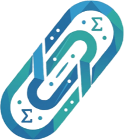

# 3c1c · ClipSAT Mathematical Animation Engine & Web Studio

<p align="center">
  
</p>

**3c1c** is **[ClipSAT](https://clipsat.org)**'s mathematical animation engine and hybrid web studio, customized from Grant Sanderson's [`3b1b/manim`](https://github.com/3b1b/manim) (`manimgl`) for **Mr. Mohamed Abdallah's** international and national exam curricula (**AP Calculus AB/BC, Digital SAT, Cambridge IGCSE & A-Level, IB Mathematics, University Linear Algebra, and Saudi GAT Qudrat / SAAT Tahsili**).

---

## ✨ What's Customized for ClipSAT (`3c1c`)

1. **Hybrid Web Studio ([`index.html`](index.html), [`web/`](web/), [`server/app.py`](server/app.py))**:
   - **Zero-Install Browser Engine ([`web/js/engine.js`](web/js/engine.js))**: 60 FPS high-DPI HTML5 Canvas mathematical animation studio with interactive point dragging, timeline keyframe scrubbing, KaTeX rigor cards, accessible *"View as Data"* numerical tables, client-side **PNG** & **WebM** clip recording, and 100% static GitHub Pages compatibility.
   - **Python FastAPI Render Backend ([`server/app.py`](server/app.py), [`server/headless_renderer.py`](server/headless_renderer.py))**: Discovers `ClipSATScene` classes, AST-validates custom Python scene scripts, and renders downloadable **H.264 `.mp4`** clips (using native `manimlib` WebGPU/Vulkan when available or the built-in CPU/FFmpeg headless renderer).
2. **ClipSAT Design System & Visual Grammar ([`manimlib/default_config.yml`](manimlib/default_config.yml), [`manimlib/constants.py`](manimlib/constants.py), [`manimlib/clipsat.py`](manimlib/clipsat.py))**:
   - **Dual Editorial Themes**: **Dark Slate (`#0A0D14`)** and **Editorial Paper (`#FAF7F2`)** (`--paper` CLI flag or one-click toggle in the studio).
   - **ClipSAT Color Tokens**: `CLIPSAT_INDIGO` (`#132746` / `#7DA4E8` for primary curves & derivatives), `CLIPSAT_AMBER` (`#9E6515` / `#F59E0B` for integrals, Riemann partitions & secants), `CLIPSAT_TEAL` (`#0C7A6F` / `#2DD4BF` for exact convergence & basis vectors), and `COLORMAP_CLIPSAT`.
   - **Multi-Format Aspect Presets**: `16:9` Lesson (`1920×1080`), `9:16` Vertical Short (`--short`, `1080×1920`), and `1:1` Exam Card (`--square`, `1080×1080`).
   - **`ClipSATScene` Base Class ([`manimlib/clipsat.py`](manimlib/clipsat.py))**: Built-in `build_exam_header(track, title)`, `build_clipsat_watermark()`, and `highlight_callout(mobject)`.
3. **165 Zero-Redundancy Interactive 2D, 3D & Compass-and-Straightedge Curriculum Scenes ([`clipsat_scenes.py`](clipsat_scenes.py), [`web/js/scenes_catalog.js`](web/js/scenes_catalog.js), [`web/js/scenes_renderers.js`](web/js/scenes_renderers.js), [`web/js/scenes_3d.js`](web/js/scenes_3d.js))**:
   - **165 Error-Free Interactive Scenes (115 2D + 50 3D)** with zero conceptual or visual overlap, organized across **12 Curriculum Tracks** with real-time search (`#scene-search`), category filter pills (`#category-filter-bar`), interactive 2D point & 3D orbit camera dragging (`azimDeg`, `elevDeg`), live parameter sliders, KaTeX rigor cards, accessible numerical data tables, and valid `ClipSATScene` Python code generation:
     - **Geometrical Constructions (15 Compass-and-Straightedge Scenes)**: Perpendicular Bisector & Equidistant Locus (Euclid I.10), Angle Bisector Rhombus Construction (Euclid I.9), Vesica Piscis Equilateral Triangle & Exact $60^\circ / 30^\circ$ (Euclid I.1), Dropping a Perpendicular from an External Point (Euclid I.12), Erecting a $90^\circ$ Normal at a Point on a Line (Euclid I.11), Parallel Line via Copying an Alternate Angle (Euclid I.31), Dividing a Segment into $N$ Equal Parts via Auxiliary Ray (Euclid VI.9), Tangents to a Circle from an External Point via Thales Semicircle (Euclid III.17), External Common Bitangents to Two Circles via Auxiliary Circle $r_1 - r_2$ (Monge Reduction), Geometric Mean $\sqrt{ab}$ & Squaring the Rectangle (Euclid II.14 & VI.13), Golden Ratio $\varphi$ & Ptolemy's Regular Pentagon Construction (Euclid IV.11), Incircle of a Triangle via Angle Bisectors & Apothem $r = \Delta/s$ (Euclid IV.4), Circle Through Three Non-Collinear Points / Circumcircle (Euclid IV.5), Six-Petal Compass Daisy Rosette, Regular Hexagon & Dodecagon (Euclid IV.15), and Circle of Apollonius ($|PA|/|PB| = k$) via Internal & External Bisectors.
     - **3D Math & Surfaces (50 Interactive 3D Scenes)**: Elliptic Paraboloid, Hyperbolic Paraboloid Saddle, Hyperboloid of One Sheet (Doubly Ruled Lines), Hyperboloid of Two Sheets, Triaxial Ellipsoid, Double Quadric Cone & Conic Slices, Monkey Saddle ($z=x^3-3xy^2$), 3D Radial Sinc Wave, **Hopf Fibration $S^3 \to S^2$ (Linked Villarceau Circles)**, Helicoid to Catenoid Minimal Surface Morph, 3D Tangent Plane & Normal Vector, Partial Derivative Slicing Planes ($\partial f/\partial x, \partial f/\partial y$), Directional Derivative $D_{\mathbf{u}}f$, **Spherical Geodesic Triangle & Girard's Excess ($E = \alpha+\beta+\gamma-\pi$)**, 3D Hessian Classification, 3D Lagrange Multiplier Cylinder Tangency, **Enneper Self-Intersecting Minimal Surface**, **Developable Oloid Convex Hull ($A=4\pi r^2$)**, 3D Implicit Level Surface $\nabla F \perp S$, 3D Multivariable Chain Rule Space Path, 3D Double Integral Riemann Prisms, Fubini's Theorem Iterated Slicing Curtain, Cylindrical Coordinates $(r,\theta,z)$ Wedge, Spherical Coordinates $(\rho,\phi,\theta)$ Sector & Jacobian, **Archimedes' Bicylinder / Steinmetz Solid ($V=\frac{16}{3}r^3$)**, Pappus's Centroid Theorem Torus, Cavalieri's Principle 3D Solids, 3D Simplex Tetrahedron Volume, 3D Helix & Frenet-Serret Triad $(\mathbf{T},\mathbf{N},\mathbf{B})$, Viviani's Temple Window Curve on Sphere, $(p,q)$ Torus Knot & Seifert Genus, Möbius Strip Non-Orientable Holonomy, Villarceau Bitangent Circles on Torus, 3D Helical Vortex Vector Field, Gauss Divergence Theorem Flux Sphere, Stokes' Theorem Paraboloid Cap Circulation, 3D Cross Product Right-Hand Rule, Scalar Triple Product Parallelepiped Volume, 3D Plane Normal Equation, 3D Skew Lines & Common Perpendicular Bridge, 3D SVD Ellipsoid Principal Axes, Rodrigues' 3D Axis-Angle Rotation Cone, Platonic Solids & Euler's Formula ($V-E+F=2$), Riemann Sphere Stereographic Projection, Lorenz Butterfly Strange Attractor, Rössler Folded-Band Attractor, 2D Wave Equation 3D Drumhead Eigenmode, Charged Particle Lorentz Cyclotron Helix, 3D Inclined Keplerian Orbit & Angular Momentum, and Quantum Bloch Sphere Qubit State $|\psi\rangle$.
     - **Calculus (22 Scenes)**: Derivative Secant Limit, Riemann Sum, Taylor Series, Mean Value Theorem, **Darboux's Theorem & Squeeze Oscillations ($x^2\sin(1/x)$)**, IVT, FTC Accumulation, L'Hôpital's Rule, **$(\varepsilon,\delta)$ Limit Adversarial Game**, Newton-Raphson, Secant Method, Bisection, Fixed-Point Iteration, Simpson's $1/3$ Rule, **Cantor Set & Devil's Staircase ($F'(x)=0$ a.e.)**, Arc Length Rectification, **Weierstrass Nowhere-Differentiable Fractal Curve**, Brachistochrone Cycloid, Epicycloid & Nephroid Caustic, Butterfly Transcendental Polar Curve, Rhodonea Rose Petals, Osculating Circle & Evolute.
     - **Linear Algebra (10 Scenes)**: Eigenvalue Transform, **Gershgorin Circle Theorem Eigenvalue Discs**, Gram-Schmidt Orthogonalization, Least Squares Orthogonal Projection, **Trace-Determinant $(\operatorname{tr}A, \det A)$ Poincaré Stability Plane**, **Perron-Frobenius Positive Cone & Dominant Eigenvector**, Householder Reflection, **Cayley-Hamilton Characteristic Annihilation**, Markov Chain Steady State, Positive Definite Quadratic Form.
     - **SAT / Algebra (10 Scenes)**: Completing the Square, Discriminant & Roots, Vieta's Formulas, Rational Asymptotes & Holes, Absolute Value Inequality, Exponential vs Linear Growth, System of Linear Inequalities, Parabola Focus & Directrix, Ellipse Foci & Eccentricity, Hyperbola Asymptotes.
     - **Geometry & Trig (12 Scenes)**: Unit Circle Exact Ratios, Inscribed Angle Theorem, Thales' Theorem, Power of a Point, Ceva's Theorem, Menelaus' Theorem, Euler Line ($O, G, H$), **Feuerbach's Nine-Point Circle & Incircle Tangency**, Law of Sines & Circumcircle, Law of Cosines, Heron's Area Formula, Ptolemy's Cyclic Quad Theorem.
     - **Probability & Stats (10 Scenes)**: Normal Distribution & Z-Score, Binomial vs Normal CLT, Poisson Rare Events, Exponential Memoryless PDF/CDF, Beta Conjugate Prior, Chi-Square Goodness of Fit, Student's $t$-Distribution, Bayes' Theorem Posterior Tree, OLS Linear Regression & Residuals, Confidence Interval Coverage.
     - **Qudrat & Olympiad (12 Scenes)**: Quantitative Comparison ($2^x$ vs $x^2+2$), Difference of Squares Shortcut, Telescoping Series Cancellation, AM-GM Inequality Semicircle Proof, Cauchy-Schwarz Vector Proof, Jensen's Convexity Inequality, Inscribed Square in Right Triangle, Hippocrates Shaded Lunes, Harmonic Mean Average Speed Trap, Successive Percentage Trap, Work-Rate Combined Pipes, Clock Hands Angle Formula.
     - **Complex & Fourier (8 Scenes)**: De Moivre Roots of Unity, Fourier Square Wave Synthesis, **Nyquist-Shannon Sampling & Aliasing Folding**, **Hilbert Transform & Analytic Signal Phasor**, **Laplace Transform $s$-Plane Poles & ROC**, Lissajous Phase Figures, Convolution Moving Average, Beat Frequency & AM Envelope.
     - **Optimization & ML (4 Scenes)**: Gradient Descent Trajectory, Saddle Point Minimax, Softmax Temperature Scaling, Sigmoid vs ReLU Activation & Vanishing Gradient.
     - **Physics & ODEs (7 Scenes)**: Simple Harmonic Oscillator Phase Portrait, Lotka-Volterra Predator-Prey, Logistic Carrying Capacity Slope Field, **Green's Theorem 2D Microscopic Curl Circulation**, **Gravitational Lensing & Einstein Ring Deflection**, ** Acoustic Doppler Effect & Supersonic Mach Cone**, **Minkowski Spacetime Diagram & Lorentz Light Cone**, Projectile Motion Parabola & Safety Envelope, Snell's Law & Total Internal Reflection.
     - **Discrete & Number (5 Scenes)**: Fibonacci Golden Spiral, Pascal's Triangle Sierpinski Mod 2, Modular Multiplicationioid Cardioid, Collatz $3n+1$ Stopping Trajectory, Prime Sieve Density vs $x/\ln x$.

---

## 🚀 Quick Start

### 1. Launch the Hybrid Web Studio (Browser + Python MP4 Backend)

```bash
python3 -m server.app --host 0.0.0.0 --port 8000
# Or via uvicorn directly:
uvicorn server.app:app --host 0.0.0.0 --port 8000
```

Then open `http://localhost:8000` (or open [`index.html`](index.html) directly as a static site / on GitHub Pages).

### 2. Render Scenes from the `3c1c` CLI

```bash
# Install in editable mode (with optional FastAPI web studio extras)
pip install -e ".[web]"

# Render in ClipSAT Dark Slate (1080p 16:9)
3c1c clipsat_scenes.py DerivativeTangentScene -w --hd

# Render on ClipSAT Editorial Paper (#FAF7F2)
3c1c clipsat_scenes.py RiemannIntegralScene -w --paper

# Render a 9:16 vertical short clip (1080x1920)
3c1c clipsat_scenes.py CompletingTheSquareScene -w --short
```

---

## 📄 License & Credits

- **ClipSAT Customization & Web Studio (`3c1c`)**: Designed for **[ClipSAT](https://clipsat.org)** by **Mr. Mohamed Abdallah**.
- **Upstream `manimgl` Engine**: Copyright (c) [3Blue1Brown LLC (Grant Sanderson)](https://github.com/3b1b/manim), MIT License.
